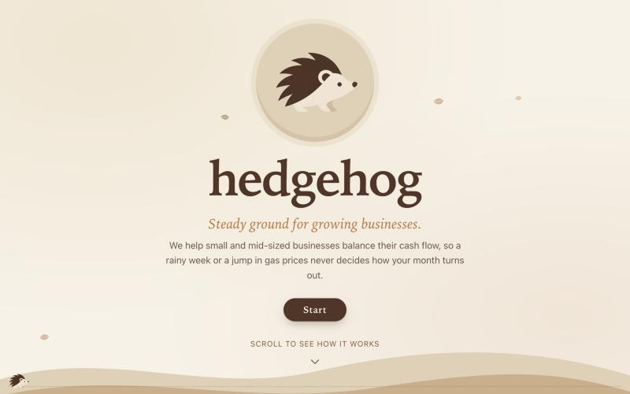
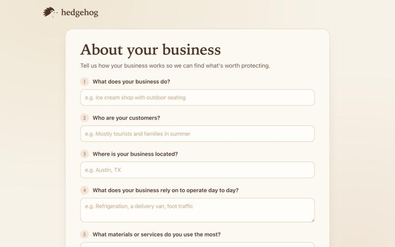
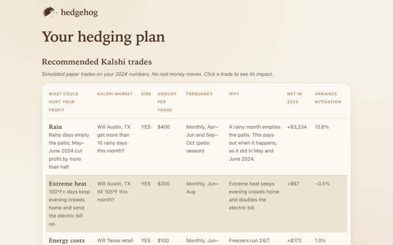

<div align="center">


# hedgehog

### Steady ground for growing businesses.

Hedgehog turns the outside forces that move a small business's revenue — weather, fuel, energy, rates — into a small, sized hedge on [Kalshi](https://kalshi.com), so a rainy week or a jump in gas prices never decides how the month turns out.

[](#)
[](#tech-stack)
[](#tech-stack)
[](#tech-stack)
[](#tech-stack)

**[Try the live demo → hedge-hog-sigma.vercel.app](https://hedge-hog-sigma.vercel.app)**

</div>

<br />

<p align="center">
  
</p>

## The problem

A rainy Saturday empties the patio. A spike in fuel prices eats into every delivery. Small businesses live or die by factors they can see coming but can't control — and have no practical way to protect themselves against.

## The idea

Hedgehog finds the outside forces that actually move a business's revenue, and pairs each one with a small, offsetting position on a real prediction market. When a tough day comes, the hedge helps cover it. When the sun is out, the business does what it does best.

No spreadsheets, no trading experience, no manual market research — the business owner answers a few plain-English questions, and Hedgehog does the rest.

## How it works

| | | |
|:---:|:---:|:---:|
| **1. Tell us about your business** | **2. See what you can hedge** | **3. Get a balanced plan** |
| Share what moves your sales — weather, fuel, ingredients — and upload your recent financials. | An LLM reads your answers and your numbers to spot the outside trends that are actually putting your revenue at risk right now. | We size small positions on Kalshi against your risk budget, so a bad month gets covered without betting the business. |

<p align="center">
  
  
</p>

## Tech stack

| Layer | Choice |
|---|---|
| Frontend | React 19 + TypeScript, built with Vite, charts via Recharts |
| Backend | FastAPI (Python), test-driven with pytest |
| Model | `Qwen/Qwen3.8-27B-FP8`, served via an OpenAI-compatible endpoint hosted on **Akamai** |
| Markets | [Kalshi](https://kalshi.com) prediction markets for live pricing and paper trading |
| Hosting | Frontend and backend on Vercel (one project, two services); model on Akamai |

See [TECHSTACK.md](TECHSTACK.md) for the full, living record of stack decisions and the frontend↔backend API contract, and [CLAUDE.md](CLAUDE.md) for product context and the end-to-end flow.

## Getting started

**Prerequisites:** Python 3.10+, Node 20+

**Backend**
```bash
cd backend
python3 -m venv venv
./venv/bin/pip install -r requirements.txt
cp .env.example .env   # fill in AKAMAI_API_KEY
./venv/bin/uvicorn app.main:app --reload
```

**Frontend**
```bash
cd frontend
npm install
npm run dev
```

The frontend calls the backend at `/api`, which `npm run dev` proxies to `http://localhost:8000`, so start the backend first. Upload a financials CSV with a month column and a profit column (the demo CSVs in `demo-data/` work as-is); an analysis takes about 1–2 minutes. To demo without a backend, set `VITE_USE_MOCK_API=true` (see `frontend/.env.example`) and the results page shows the simulated Two Scoops Creamery plan.

**Tests**
```bash
cd backend && ./venv/bin/pytest
cd frontend && npm run test
```

## Project structure

```
hedgehog/
├── frontend/          React + TypeScript app (home → questionnaire → results)
├── backend/           FastAPI app (questionnaire ingestion, LLM calls)
│   └── app/
│       ├── routes/analyze.py      POST /api/analyze
│       ├── pipeline.py            runs the whole analysis, step by step
│       ├── questionnaire.py       parses the 9-question intake form
│       ├── csv_parsing.py         financials CSV ingestion
│       ├── financial_history.py   picks the year to simulate; expected vs. actual profit
│       ├── prompts.py             system prompts for both model calls
│       ├── trend_detection.py     Model call 1: what can this business hedge?
│       ├── kalshi_client.py       live Kalshi market data (public API)
│       ├── market_catalog.py      which Kalshi series to offer, plus an offline fallback
│       ├── position_sizing.py     Model call 2: which markets, which side, how much
│       ├── risk_budget.py         reads the owner's budget ("$800 a month")
│       ├── backtest.py            budget scaling and simulated monthly payouts
│       ├── hedge_report.py        the response the results page renders
│       ├── model_json.py          parses JSON replies from the model
│       └── akamai_client.py       HTTP client for the Akamai-hosted model
├── demo-data/         two hand-built fictional businesses used for every demo
└── docs/              implementation plans, screenshots
```

## Demo data

Every demo runs against two fully hand-built fictional businesses in [`demo-data/`](demo-data) — **Two Scoops Creamery** (an Austin ice cream shop, 129 months of financials, weather- and energy-driven risk) and **Quillstack AI** (an SF AI startup, GPU/token-price and funding-market risk). Each comes with a ready-to-paste set of questionnaire answers and a "what Hedgehog should find" checklist, so results are reproducible and judge-able.

## Status

Built end-to-end for the hackathon demo:
- ✅ Landing → questionnaire → results flow (frontend)
- ✅ `POST /api/analyze` backend endpoint, fully tested
- ✅ Real LLM call to the Akamai-hosted model: given a business's answers and financials, it identifies hedgeable risk categories with grounded reasoning
- ✅ Live Kalshi market data from the public API, with a built-in fallback list if Kalshi is unreachable
- ✅ Second LLM call for position sizing: the hedgeable categories from the first call go in, sized Kalshi trades (market, side, stake, months) come out, scaled to the owner's risk budget
- ✅ Each trade is simulated against the business's worst recent year from its own CSV; the results page shows the payouts and how much of the bad-month shortfall they cover
- Trades are paper only: no real money moves

## Team & acknowledgments

Built at **Hackmidwest 2026**, running on a model endpoint and compute generously provided by **Akamai** for the event, against real **Kalshi** market structure.
